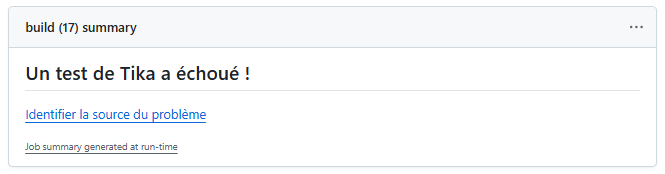

<!-- IFT3913-TACHE3-START -->
# Tâche 3

## Détection automatique des vulnérabilités avec Semgrep

### Implémentation

Nous avons ajouté un nouveau job `semgrep` dans le fichier `.github/workflows/main-jdk17-build.yml` pour détecter les nouvelles vulnérabilités dans le code de Tika. Ce job est indépendant et se trouve au même niveau que les jobs `build` et `e2e-tests`, sans modifier leur fonctionnement.

Le job `semgrep` exécute les étapes suivantes :

- **Récupération du code :** `actions/checkout@v6` récupère le dépôt. Nous utilisons `fetch-depth: 0` pour avoir accès à tout l'historique Git, nécessaire pour comparer les commits.
- **Choix du commit de référence :** l'étape `reference` détermine automatiquement le commit avec lequel les modifications seront comparées.
- **Installation :** la commande `pip install semgrep==1.185.0` installe Semgrep sur la machine utilisée par GitHub Actions.
- **Analyse :** l'option `--config rapports-semgrep/java-rules.yaml` utilise un instantané des règles publiques Java `p/java` (60 règles, récupérées le 16 novembre 2026). `--no-rewrite-rule-ids` conserve les identifiants originaux. Le fichier de règles et la version 1.185.0 de Semgrep sont figés pour rendre les analyses comparables. L'option `--baseline-commit` permet de repérer les nouvelles vulnérabilités et `--error` fait échouer le job lorsqu'une nouvelle vulnérabilité est détectée.
- **Rapport :** les options `--json` et `--output` enregistrent les résultats dans `semgrep-resultat.json`. Le fichier est ensuite conservé comme artefact GitHub Actions sous le nom `rapport-semgrep`, même lorsque l'analyse échoue. L'option `--metrics=off` désactive l'envoi des métriques à Semgrep.

### Comparaison avec un commit de référence

Nous utilisons `--baseline-commit` pour détecter uniquement les nouvelles vulnérabilités. Le commit de référence correspond au commit précédent pour un push ou au commit de base pour une pull request. Si cette référence est indisponible, `git merge-base` permet de trouver un point de comparaison avec `main`.

### Validation

Nous avons vérifié le fonctionnement de Semgrep localement, puis sur GitHub Actions, afin de tester les deux situations : une analyse réussie et une analyse qui détecte une nouvelle vulnérabilité.

**Vérification locale**

Nous avons vérifié que Semgrep détecte les vulnérabilités dans chaque fichier Java modifié à l'aide de la commande suivante :

```bash
semgrep scan --config p/java --metrics=off chemin/du/fichier.java
```

**Aucune nouvelle vulnérabilité**

Nous avons vérifié que le job `semgrep` s'exécute correctement et se termine avec succès lorsqu'aucune nouvelle vulnérabilité n'est détectée. [Exécution réussie](https://github.com/nass1379/tika/actions/runs/43544299763/job/132291819827)

**Nouvelles vulnérabilités**

Lorsqu'un commit introduit une nouvelle vulnérabilité détectée par Semgrep, le job `semgrep` passe en échec avec un code de sortie 1. [Exécution en échec](https://github.com/nass1379/tika/actions/runs/43553274275/job/132320316336)


## Vulnérabilités

### Vulnérabilité 1 : hachage faible (MD5)

- **Type :** utilisation d'un algorithme de hachage cryptographique faible.
- **Choix du fichier :** `tika-core/src/main/java/org/apache/tika/utils/ProcessUtils.java`.  
  Cette classe regroupe des méthodes statiques liées à la gestion des processus dans Tika. Nous y avons ajouté une méthode indépendante, qui n'est pas appelée par les méthodes existantes. Leur comportement ne change donc pas.
- **Code ajouté :**  
  La méthode `insecureHash(String value)` utilise MD5 pour calculer l'empreinte d'une chaîne de caractères et retourne le résultat sous forme de tableau d'octets.
- **Pourquoi c'est vulnérable :**  
  MD5 est vulnérable aux collisions : deux données différentes peuvent produire la même empreinte. Son utilisation peut compromettre les mécanismes qui reposent sur la résistance aux collisions, comme certaines vérifications d'intégrité ou d'authenticité. SHA-256 serait préférable pour ces usages.
- **Résultat Semgrep :**  
  Nous avons analysé `ProcessUtils.java` avec les règles Java (`p/java`). Semgrep a détecté l'utilisation de MD5 et l'a signalée comme une faiblesse de sécurité. [Run](https://github.com/nass1379/tika/actions/runs/43553274275/job/132320316336)

### Vulnérabilité 2 : injection SQL

- **Type :** injection SQL.
- **Choix du fichier :** `tika-core/src/main/java/org/apache/tika/metadata/Metadata.java`.  
  Cette classe sert à gérer les métadonnées des documents dans Tika. Ces valeurs peuvent provenir de documents non fiables, ce qui rend leur enregistrement dans une base de données pertinent pour illustrer une injection SQL.
- **Code ajouté :**  
  La méthode `saveToDatabase(Connection conn, String key)` permet d'enregistrer une métadonnée dans une base de données. Elle construit la requête SQL en concaténant directement la clé et sa valeur.
- **Pourquoi c'est vulnérable :**  
  La requête est construite à partir de valeurs qui pourraient provenir d'une source non fiable. Si l'une contient des caractères ou des instructions SQL malveillantes, elle pourrait modifier la requête exécutée. Un `PreparedStatement` avec des paramètres permettrait de séparer les données de la commande SQL et d'éviter ce problème.
- **Résultat Semgrep :**  
  Nous avons analysé `Metadata.java` avec `p/java`. L'injection SQL a été détectée (`1 finding`, `1 blocking`). [Run](https://github.com/nass1379/tika/actions/runs/43632586929/job/132562258032)

### Vulnérabilité 3 : XML External Entity (XXE)

- **Type :** XML External Entity (XXE).
- **Choix du fichier :** `tika-core/src/main/java/org/apache/tika/sax/OfflineContentHandler.java`.  
  Cette classe fait partie des composants de Tika liés au traitement du contenu XML avec SAX, ce qui en fait un endroit pertinent pour introduire une vulnérabilité liée au traitement XML.
- **Code ajouté :**  
  La méthode `parseXML(InputStream input)` analyse un document XML avec `DocumentBuilderFactory`, sans configurer le parseur pour bloquer les entités externes.
- **Pourquoi c'est vulnérable :**  
  Le parseur est créé sans configuration de sécurité contre les entités externes. Selon sa configuration, un document XML malveillant pourrait exploiter cette faiblesse pour tenter de lire des fichiers locaux ou d'accéder à des ressources internes. Il faudrait notamment désactiver les déclarations `DOCTYPE` et la résolution des entités externes.
- **Résultat Semgrep :**  
  Nous avons analysé `OfflineContentHandler.java` avec `p/java`. La vulnérabilité XXE a été détectée (`1 finding`, `1 blocking`). [Run](https://github.com/nass1379/tika/actions/runs/43635358793/job/132570853817)

### Vulnérabilité 4 : chiffrement AES en mode ECB

- **Type :** fuite des motifs du texte clair par chiffrement déterministe des blocs (CWE-327), distincte des collisions du hachage MD5 de la vulnérabilité 1.
- **Fichier et méthode :** [`ProcessUtils.java`](tika-core/src/main/java/org/apache/tika/utils/ProcessUtils.java), `insecureEncrypt(byte[], SecretKey)`. Comme le helper de hachage ajouté pour l'expérience, cette méthode indépendante illustre un traitement des octets d'un document avant transmission ou stockage. Ce placement est pédagogique ; le chiffrement n'est pas une responsabilité habituelle de cette classe de gestion des processus.
- **Code :** `Cipher.getInstance("AES/ECB/PKCS5Padding")`, puis `init(ENCRYPT_MODE, key)` et `doFinal(content)`.
- **Pourquoi :** avec une même clé, deux blocs clairs identiques produisent deux blocs chiffrés identiques. Le contenu reste chiffré, mais les répétitions sont visibles ; ECB n'apporte pas non plus d'authentification. L'alternative serait un chiffrement authentifié comme AES-GCM, avec un nonce unique par clé et par message.
- **Détection :** `java.lang.security.audit.crypto.use-of-aes-ecb.use-of-aes-ecb` (WARNING), une nouvelle occurrence dans ce fichier. Le détecteur reconnaît explicitement le mode ECB passé à `getInstance` ; il n'exécute pas le chiffrement. Une occurrence dans `HwpTextExtractorV5` existait déjà et n'est pas comptée comme notre ajout.

### Vulnérabilité 5 : transmission de document sans TLS

- **Type :** transmission en clair de données potentiellement sensibles (CWE-319).
- **Fichier et méthode :** [`NetworkParser.java`](tika-core/src/main/java/org/apache/tika/parser/NetworkParser.java), `insecureSendDocument(String, int, byte[])`. Cette classe échange déjà des documents avec des services distants ; l'envoi de contenu s'inscrit donc dans sa fonction réseau.
- **Code :** une `Socket` TCP ordinaire est ouverte, puis `content` est écrit directement sur son flux de sortie.
- **Pourquoi :** aucun TLS ni chiffrement applicatif n'est appliqué. Un observateur du réseau pourrait lire les données transmises. Le caractère sensible dépend du contenu effectivement envoyé. La correction serait un transport TLS avec validation du certificat et de l'identité du serveur.
- **Détection :** `java.lang.security.audit.crypto.unencrypted-socket.unencrypted-socket` (WARNING). Le rapport initial signale déjà la socket du chemin `telnet` dans cette même classe. La nouvelle méthode ajoute une **seconde occurrence** : comparer uniquement les noms de règles ou de fichiers ferait manquer cet ajout.

### Vulnérabilité 6 : désérialisation JSON polymorphe non sûre

- **Type :** désérialisation de données non fiables (CWE-502).
- **Fichier et méthode :** [`TikaObjectMapperFactory.java`](tika-serialization/src/main/java/org/apache/tika/config/loader/TikaObjectMapperFactory.java), `insecureReadPolymorphicJson(String)`. Cette classe configure les mappers Jackson ; le choix du fichier est lié directement à la configuration de la désérialisation.
- **Code :** création d'un `ObjectMapper`, appel de `enableDefaultTyping()` sans liste de types autorisés, puis `readValue(json, Object.class)`.
- **Pourquoi :** les informations de type du JSON peuvent sélectionner des classes au lieu d'un type métier fixé par l'application. Si une entrée non fiable est acceptée et que des classes exploitables sont présentes dans le classpath, cela peut provoquer des effets indésirables, voire une exécution de code. La détection ne prouve pas à elle seule qu'une chaîne d'exploitation existe avec les dépendances actuelles. Préférer un DTO explicite, ou une liste restrictive de types autorisés si le polymorphisme est indispensable.
- **Détection :** `java.lang.security.jackson-unsafe-deserialization.jackson-unsafe-deserialization` (WARNING). La règle reconnaît l'activation du typage suivie de `readValue`. L'annotation `SuppressWarnings("deprecation")` ne supprime que l'avertissement Java de dépréciation, pas l'alerte Semgrep.

### Vulnérabilité 7 : traversée de chemins

- **Type :** lecture d'un fichier hors du répertoire prévu (CWE-22).
- **Fichier et méthode :** [`MetadataResource.java`](tika-server/tika-server-core/src/main/java/org/apache/tika/server/core/resource/MetadataResource.java), `insecureReadMetadataFile(@PathParam("name") String)` ; le fichier représente la ressource serveur liée aux métadonnées.
- **Code :** `new File("metadata", name)`, puis `Files.readAllBytes(file.toPath())`, sans normalisation ni vérification que le chemin reste sous `metadata`.
- **Pourquoi :** une valeur telle que `../outside.txt` peut sortir du répertoire prévu, si le fichier est accessible au processus. Il faudrait résoudre et normaliser le chemin, vérifier son appartenance au répertoire autorisé et traiter aussi les liens symboliques.
- **Détection :** `java.jax-rs.security.jax-rs-path-traversal.jax-rs-path-traversal` (WARNING). La règle associe le paramètre annoté `PathParam` à la construction de `File`.
- **Limite de portée :** cette méthode n'a pas d'annotation HTTP `GET`/`POST` et n'est pas enregistrée comme nouveau point d'accès. Elle est vulnérable si un appelant lui transmet un nom non fiable ; cette expérience ne démontre pas un accès distant via une route existante.

**Portée commune des quatre ajouts.** Ce sont des méthodes pédagogiques dans le code de production du cas d'étude, sans appel ajouté dans les parcours existants. Elles compilent et sont détectées statiquement. Aucun serveur vulnérable n'a été déployé et aucune charge d'exploitation n'a été exécutée. Les sept types sont MD5, SQLi, XXE, AES-ECB, transport en clair, désérialisation polymorphe et traversée de chemins. MD5 et AES-ECB partagent une famille cryptographique et le CWE-327, mais correspondent à deux mécanismes de faiblesse différents.

## Rickroll

### Implémentation

Nous avons créé une action réutilisable dans `.github/actions/rickroll/action.yml` pour afficher un Rickroll lorsqu'un test de Tika échoue.

L'action vérifie les rapports de tests Maven (Surefire et Failsafe) pour repérer les balises `<failure>` ou `<error>`. Si un échec est détecté, elle ajoute au résumé GitHub Actions un lien intitulé « Identifier la source du problème », qui mène à la vidéo Rickroll. Cette action est appelée dans `.github/workflows/main-jdk17-build.yml`, après les étapes Maven des jobs `build` et `e2e-tests`.

### Validation

Nous avons vérifié sur GitHub Actions que le Rickroll s'affiche dans le résumé après un échec Maven. [Exécution sur GitHub Actions](https://github.com/nass1379/tika/actions/runs/43544299763)

Vérification locale complémentaire du 16 novembre : le script de l’action a été exécuté dans des répertoires temporaires avec trois rapports Surefire synthétiques. Aucun Rickroll pour un test réussi ; Rickroll présent pour une balise `<failure>` et pour une balise `<error>`. [Résultats](rapports-semgrep/rickroll-validation.json). Cette vérification porte sur le script de l’action, pas sur une nouvelle exécution distante du workflow.




## Comparaison des rapports Semgrep

### Référence et reproductibilité

Le commit initial est `b020dd1f9` (abrégé `b020dd1f`, fourni par Dina), avant les sept ajouts. Son [rapport original](semgrep-avant.json) reste inchangé. Une extraction de ce commit et le code final ont été analysés avec **Semgrep CE 1.185.0**, le même instantané de **60 règles Java** et les mêmes options. Chaque analyse complète porte sur **1535 fichiers Java**.

| Mesure | Alertes |
|---|---:|
| Rapport initial de Dina | 11 |
| Commit initial réanalysé | 11 |
| Code final : les sept ajouts | 18 |
| Occurrences nouvelles | 7 |
| Occurrences initiales disparues | 0 |

Les 11 occurrences du rapport historique correspondent aux 11 occurrences reproduites. Les 18 alertes finales ne sont donc pas 18 vulnérabilités ajoutées : les 11 alertes préexistantes sont conservées, auxquelles s'ajoutent les sept cas de l'expérience.

Preuves : [avant reproduit](rapports-semgrep/avant-reproduit.json), [après](rapports-semgrep/apres.json), [contrôle différentiel avant commit](rapports-semgrep/differentiel-avant-commit.json), [comparaison détaillée](rapports-semgrep/comparaison.json), [règles figées](rapports-semgrep/java-rules.yaml) et [empreinte des règles](rapports-semgrep/validation.json).

### Identification des occurrences nouvelles

Le script [`compare_semgrep.py`](scripts/compare_semgrep.py) compare les triplets **identifiant de règle, chemin relatif, code signalé**, en conservant les multiplicités. Il normalise les séparateurs Windows du rapport initial et les chemins absolus du rapport reproduit. Le code initial est lu dans Git au commit de référence ; le code final est lu dans les fichiers analysés. Les numéros de ligne seuls ne servent pas d'identité, car les ajouts d'imports les déplacent. Les champs `extra.lines` et `fingerprint` des rapports CE valent `requires login` : le script ne les utilise pas comme preuves.

| Cas ajouté | Règle (suffixe) | Fichier | Avant → après pour cette règle et ce fichier |
|---|---|---|---:|
| 1 MD5 | `use-of-md5` | `ProcessUtils.java` | 0 → 1 |
| 2 SQLi | `formatted-sql-string` | `Metadata.java` | 0 → 1 |
| 3 XXE | `documentbuilderfactory-disallow-doctype-decl-missing` | `OfflineContentHandler.java` | 0 → 1 |
| 4 AES-ECB | `use-of-aes-ecb` | `ProcessUtils.java` | 0 → 1 |
| 5 Transport en clair | `unencrypted-socket` | `NetworkParser.java` | 1 → 2 |
| 6 Désérialisation | `jackson-unsafe-deserialization` | `TikaObjectMapperFactory.java` | 0 → 1 |
| 7 Traversée de chemins | `jax-rs-path-traversal` | `MetadataResource.java` | 0 → 1 |

### Commandes de reproduction

Depuis la racine du dépôt, après installation de `semgrep==1.185.0` :

```bash
# Extraire la référence sans modifier la branche courante.
BASE_DIR=$(mktemp -d)
git archive b020dd1f9 | tar -x -C "$BASE_DIR"
semgrep scan --config rapports-semgrep/java-rules.yaml --no-rewrite-rule-ids \
  --metrics=off --json --output rapports-semgrep/avant-reproduit.json "$BASE_DIR"
semgrep scan --config rapports-semgrep/java-rules.yaml --no-rewrite-rule-ids \
  --metrics=off --json --output rapports-semgrep/apres.json .
python3 scripts/compare_semgrep.py
# Après avoir commité les ajouts : échec attendu (code 1), sept alertes nouvelles.
semgrep scan --config rapports-semgrep/java-rules.yaml --no-rewrite-rule-ids \
  --baseline-commit b020dd1f9 --metrics=off --error \
  --json --output rapports-semgrep/nouvelles.json .
```

Les scans complets sans `--error` peuvent retourner 0 même avec des alertes. C'est le contrôle différentiel avec `--error` qui sert à bloquer le workflow. Pour comparer l'ensemble de l'expérience, la référence est `b020dd1f9` ; dans la CI, la référence reste le commit précédent du push ou la base de la PR. Les quatre derniers ajouts doivent donc être nouveaux par rapport au commit de Dina `aa87bf7d4`.

### Validation et limites

**Particularité de la validation sans commit.** Le contrôle `--baseline-commit b020dd1f9 --error` a retourné **1**, mais seulement **4 alertes** : SQLi, XXE, MD5 et AES-ECB. Avant commit, Semgrep 1.185.0 a sélectionné les trois fichiers Java déjà présents dans le diff entre le commit initial et HEAD ; il n'a pas inclus les trois autres fichiers modifiés uniquement dans la copie de travail. Ce résultat intermédiaire est conservé tel quel et ne doit pas être présenté comme un scan différentiel des sept ajouts. Les scans complets avant/après et leur comparaison identifient bien les sept nouvelles occurrences. Vérification complémentaire le 17 novembre 2026, après préparation du commit local avec l’identité Git de Nassim : la même commande détecte les **sept nouvelles alertes dans six fichiers Java**, avec le **code de sortie 1 attendu**. [Rapport différentiel complet](rapports-semgrep/nouvelles.json), [journal](rapports-semgrep/logs/differentiel-apres-commit.log). Le résultat distant reste à vérifier après son push.

Le 16 novembre 2026, les validations sont **locales, avant commit et push**. La preuve GitHub Actions des quatre derniers ajouts reste à obtenir après publication ; les liens de Dina plus haut concernent ses validations précédentes.

- Contrôles `spotless:check` et `checkstyle:check` des trois modules modifiés : réussis.
- Contrôle Semgrep sur un fichier inchangé depuis la référence : code de sortie 0, sans nouvelle alerte.
- Compilation des modules modifiés et de leurs dépendances : `./mvnw -B -ntp -pl tika-core,tika-serialization,tika-server/tika-server-core -am compile -Drat.skip=true -Dcheckstyle.skip=true -Dossindex.skip=true`.
- Tests core et serialization : `./mvnw -B -ntp -pl tika-core,tika-serialization -am -Pchatunitest-verify test -Drat.skip=true -Dcheckstyle.skip=true -Dossindex.skip=true`. **876 tests core + 216 tests serialization**, aucun échec ni erreur, deux tests ignorés dans chaque module. Ces tests vérifient l'absence de régression des parcours existants ; ils ne constituent pas une démonstration d'exploitation des nouveaux helpers.
- Les tests serveur n'ont pas été validés : la tentative atteignant `process-test-resources` échoue sur l'artefact local manquant `tika-pipes-file-system:zip:4.0.0-SNAPSHOT`. La compilation seule du serveur réussit. Ce problème est distinct des alertes Semgrep.
- Les deux scans comportent le même avertissement de parsing partiel dans `PipesParsingHelper.java`, fichier non modifié, et les mêmes exclusions de deux fichiers dépassant 1 Mo. L'analyse n'est donc pas une preuve d'absence de toute autre vulnérabilité. Les sept ajouts se trouvent dans des fichiers analysés sans cet avertissement.
- Le workflow est désormais déclenché sur les branches `main` **et `tache3`** (push et PR vers ces branches). Semgrep et les règles sont figés. Un push introduisant les quatre ajouts doit produire un job Semgrep rouge : c'est le comportement attendu de la tâche, pas une panne à masquer.

Les journaux de validation locale sont conservés dans [rapports-semgrep/logs](rapports-semgrep/logs).


---

#### Utilisation de l'intelligence artificielle

Les quatre derniers exemples de vulnérabilités, le script de comparaison et leur documentation ont été préparés avec l’assistance de Codex, puis vérifiés localement avec Semgrep et Maven. Les changements ont ensuite été préparés dans un commit local avec l’identité Git de Nassim ; le push est laissé à Nassim.

Claude et ChatGPT ont été utilisés pour aider à la rédaction et à la reformulation de certaines parties du README, ainsi que pour certains aspects de l'implémentation du Rickroll.
